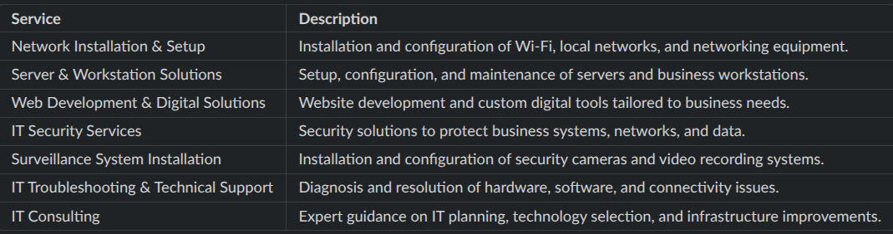

I need you to use the current full stack setup to build a back-end and front-end for an IT solutions project :
\*\* important: The coding style is a Junior developer style with clear comments and no complex AI codes.
/based on your knowledge, you can add or enhance what we forgot to mention but do not make it very complicated.
The project is aboud a medium / Small firm/ business , not for a big company.

- The attached image shows an imagined plan for the project but you can enhance it.
- The app should have a chat with us budge and chat client.
- Also private chat between employees, workers, management and customers.
- Ticket and mission tracking system.
- profiles and activities for each role.
- Well back and front end security and privacy.
- Best performance and user experience.
- rich editor to create front end content on the front end.

- The customers can be individuals, small business or firms.
- better UI for this kind of business.
- There are three Junior developer students working on the project:
  - One for the backend.
  - two for the front end.
- so wee need agents mds that tell the AI agents of the front end devs not to touch the back-end at all and only offer suggestions if needed to be passed to the back=end dev.
  -The recent build is simple and clear for the students team so no major refactoring .
- We need clear presentation mds, clear readmes and instructions and clear project descriptions with diagrams and ERDs.

Build the full-stack and after that consider a ready empty technically ready clone of the front end outside of the project so the front end devs can build what the like.
Because of their skills fail, we use your generated full-stack.

Smaples of services and products:

