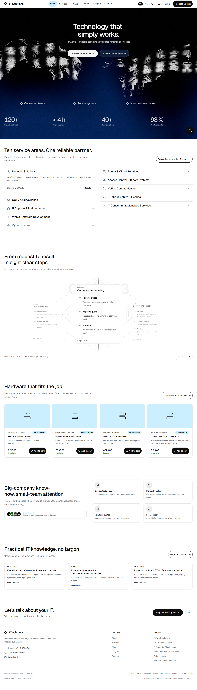

# IT Solutions. (FIA Final Project)
A bilingual web app for IT service requests, equipment orders, and customer support at a fictional IT company.

Status: in development — graduation project and team portfolio.

Built by three junior developers, this project connects a public website with customer, technician, and admin workspaces. It follows a service request through quoting, approval, scheduling, delivery, and reporting.

All company details, people, prices, and business statistics are fictional demo content. Legal pages are templates and need professional review before any real deployment.

## Screenshots



The landing page introduces the services, explains the request-to-delivery process, and shows equipment and articles from the local API. This desktop capture uses the light theme with the cookie notice dismissed.

## Features

- Browse services, equipment, and articles in English or German, with light and dark themes.
- Request a quote, send a contact message, or start a guest support chat.
- Track requests, accept or reject quotes, and view orders and invoices in the customer portal.
- Open support tickets, manage appointments, and download service reports.
- Update assigned work and submit service reports with attachments as a technician.
- Manage users, the catalog, quotes, orders, tickets, website content, and activity as an admin.
- Export personal data or request account deletion from the profile area.

### Current limitations

Development is ongoing. Payments are not processed online, email delivery is not integrated, and chat uses polling rather than WebSockets. Invoices record payment status inside the application.

Demo login shortcuts still need to be aligned with the current seeded email domain. Enter the seeded account details manually when testing. Existing databases may retain earlier account emails because the seed does not overwrite existing users.

## My Role

This is a team portfolio. The responsibilities below describe the project team's ownership rather than claiming individual contributions.

| Role | Responsibility |
| --- | --- |
| Backend developer | Express API, database, authentication, and server security in `server/` |
| Frontend developer 1 | Public and customer pages, shared components, and translations |
| Frontend developer 2 | Admin and technician interfaces, context, shared utilities, styling, and QA |

The team works against a shared API contract and uses documented handoffs for changes between frontend and backend. See the [team workflow](docs/team-workflow.md).

## Tech Stack

| Area | Tools |
| --- | --- |
| Frontend | React 19, TypeScript, Vite 8 |
| Routing and server data | TanStack Router 1, TanStack Query 5 |
| Interface | Tailwind CSS 4, shadcn/ui with Radix UI 1, Lucide icons, Motion 14 |
| Backend | Node.js, Express 5, TypeScript |
| Database | PostgreSQL, Prisma 7 with the PostgreSQL driver adapter |
| Authentication | Server-side sessions, Argon2 password hashing, HTTP-only session cookies, CSRF protection |
| Tests | Vitest, Testing Library, Playwright, and the Node.js test runner |
| Package manager | npm, with separate lock files in `client/` and `server/` |

## Design Decisions

- **Separate frontend and backend ownership:** the React client uses the documented Express API. This lets the team divide work while keeping request and response shapes consistent. API changes require a handoff rather than a change made independently by either frontend developer.
- **One origin for a production-style run:** Express serves the built frontend and `/api`. During development, Vite proxies `/api` to Express, keeping browser requests on the frontend origin.
- **Server-enforced permissions:** roles and record ownership are checked by the API. Hiding a control in the UI does not grant or remove permission. Sessions and CSRF checks are shared across the role-specific workspaces.

See the [architecture](docs/architecture.md) and [security and privacy notes](docs/security-privacy.md) for implementation details.

## Getting Started

### Requirements

- Node.js 22 or newer, as documented in the existing [setup guide](SETUP.md). The repository does not pin a Node.js version through `engines` or a version file.
- PostgreSQL 16 or newer, as documented in the setup guide, with a local server running.
- npm, Git, and PostgreSQL's `psql` command or pgAdmin. No npm version is pinned.

### Installation

1. Clone the repository:

```bash
git clone https://github.com/amborsan/FIA-Final-Project-IT-solutions.git
cd FIA-Final-Project-IT-solutions
```

2. Create the local database. This command prompts for your PostgreSQL password:

```bash
psql -h localhost -U postgres -c "CREATE DATABASE fia;"
```

3. Install the backend dependencies and create its local environment file:

```bash
cd server
npm ci
```

On macOS or Linux:

```bash
cp .env.example .env
```

On Windows PowerShell:

```powershell
Copy-Item .env.example .env
```

Edit `server/.env` so `DATABASE_URL` points to your local `fia` database using your own PostgreSQL credentials. Keep this file out of Git.

4. From `server/`, apply the committed migrations, generate the Prisma client, and load demo data:

```bash
npm run db:deploy
npm run db:generate
npm run db:seed
npm run dev
```

Run all Prisma scripts from `server/`. The seed updates catalog entries and creates missing demo users; it skips sample transactions when service requests already exist. It does not update existing demo users' emails.

5. Keep the API terminal open. In a second terminal, starting at the repository root:

```bash
cd client
npm ci
npm run dev
```

Open the [local web app](http://localhost:5173). The landing page should show services and products from the API at port 3000. Vite forwards `/api` requests to the backend. The frontend environment file is optional for this setup.

For troubleshooting and additional setup details, see [SETUP.md](SETUP.md).

### Usage

Use the public website to browse services or submit a request. Register a customer account, or enter a locally seeded demo account at the login page to explore the role-specific workspaces.

The seeded customer email is `customer@fia-it.de`; additional local accounts and their development-only passwords are defined in [the seed file](server/prisma/seed.ts). These accounts can change data and are intended for local development. Replace demo accounts before any real deployment.

### Running Tests

From `client/`, run the unit tests and check the production build:

```bash
npm test
npm run lint
npm run build
```

For browser tests, install Playwright's Chromium browser once, then run the suite from `client/`:

```bash
npx playwright install chromium
npm run test:e2e
```

Playwright starts or reuses Vite on port 5173. It does not start or seed the backend. Keep the local API running for tests that need API data. See the [test strategy](docs/testing.md).

From `server/`, run the backend checks:

```bash
npm run build
npm test
```

Backend API tests use the configured development database and create short-lived sessions. Use a local development database with demo data.

### Production-style run

From the repository root, build the frontend, then check and start the backend:

```bash
cd client
npm run build
cd ../server
npm run build
npm start
```

Open the [locally served build](http://localhost:3000). Express serves `client/dist` alongside the API. The backend build generates Prisma and checks TypeScript; `npm start` runs the TypeScript server through `tsx`.

For deployment, configure HTTPS, production environment values, backups, and real company content. Review the [security notes](docs/security-privacy.md) and [German legal checklist](docs/legal-checklist-de.md).

## Environment Variables

Backend variables belong in `server/.env`. The optional frontend override belongs in `client/.env`. Example files are [server/.env.example](server/.env.example) and [client/.env.example](client/.env.example).

| Name | Required | Purpose | Where to get it |
| --- | --- | --- | --- |
| `DATABASE_URL` | Yes | Connect Prisma to PostgreSQL | Your local PostgreSQL host, port, database, username, and password |
| `PORT` | No | API listening port; defaults to `3000` | Choose an available local port; update the Vite proxy if changing it |
| `HOST` | No | API listening host; defaults to `localhost` | Your local or deployment network configuration |
| `CLIENT_ORIGIN` | No for local defaults; configure for deployment | Comma-separated browser origins allowed by CORS | The frontend origins used in your environment; the example includes local ports 5173 and 3000 |
| `NODE_ENV` | No for development; set for production | `production` enables secure cookies and trust proxy | Set according to the deployment environment; use HTTPS for production cookies |
| `VITE_API_URL` | No | Override the frontend API base URL; defaults to `/api` | Your API base URL if hosted separately, including its `/api` path |
| `CLIENT_DIST` | No | Override the static frontend directory; defaults to `../client/dist` | Your build output location; supported in `server/src/app.ts` but absent from the example file |

`VITE_*` values are included in the browser bundle and must never contain secrets. Never commit `.env` files or use the example database password for a real deployment.

## Project Structure

```text
.
├── client/
│   ├── src/routes/          Public pages and role-specific workspaces
│   ├── src/components/      Shared UI, layouts, and interface primitives
│   ├── src/context/         Authentication, cart, and theme state
│   ├── src/i18n/            English and German translations
│   ├── src/lib/             API client, shared types, and utilities
│   ├── src/styles/          Shared design tokens
│   └── e2e/                 Playwright browser tests
├── server/
│   ├── prisma/              Database schema, migrations, and demo seed
│   ├── src/controllers/     Request handling and business logic
│   ├── src/routes/          API routes and middleware wiring
│   ├── src/middleware/      Authentication, CSRF, limits, and errors
│   ├── src/auth/            Password and session helpers
│   └── test/                Backend tests
├── docs/                    Architecture, API, testing, and handoffs
├── agents/                  Team role instructions
├── scripts/                 Frontend boundary check
├── SETUP.md                 Detailed local setup and troubleshooting
└── LICENSE                  MIT license
```

### Documentation

| Document | Contents |
| --- | --- |
| [Project description](docs/project-description.md) | Problem, goals, user journeys, and scope |
| [Architecture](docs/architecture.md) | System layout and request lifecycle |
| [Database ERD](docs/database-erd.md) | Relations and data dictionary |
| [API reference](docs/api.md) | Endpoints, payloads, and permissions |
| [Testing](docs/testing.md) | Test strategy and manual QA |
| [Team workflow](docs/team-workflow.md) | Ownership, Git workflow, and handoffs |
| [Frontend-to-backend handoffs](docs/handoffs/frontend-to-backend.md) | Backend requests and their status |
| [Backend-to-frontend handoffs](docs/handoffs/backend-to-frontend.md) | Contract changes announced by the backend |
| [Demo script](docs/demo-script.md) | Presentation walkthrough |

Some supporting documents still contain earlier branding. The current interface uses **IT Solutions.**, and newly seeded accounts use **fia-it.de**.

## Author

Created by the **project team**: three junior developers building a graduation project and portfolio web app. Individual credits and contact details will be added when the team is ready to publish them.

## License

Licensed under the [MIT License](LICENSE). Third-party packages and bundled fonts retain their own licenses.
