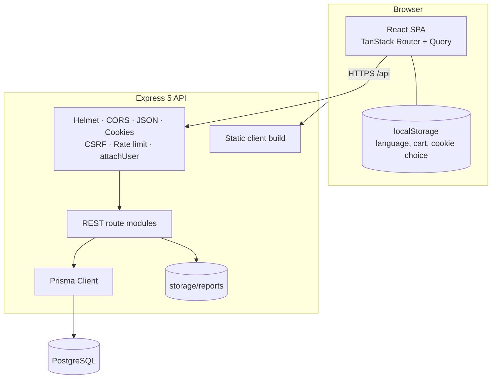
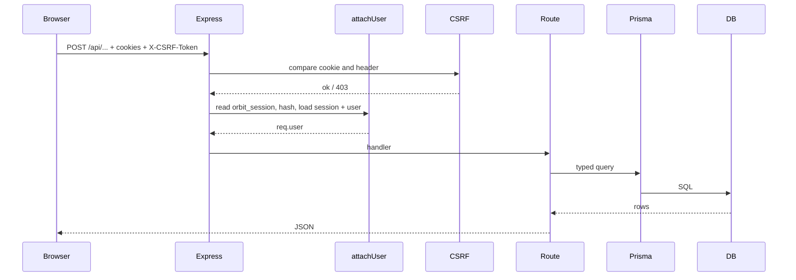
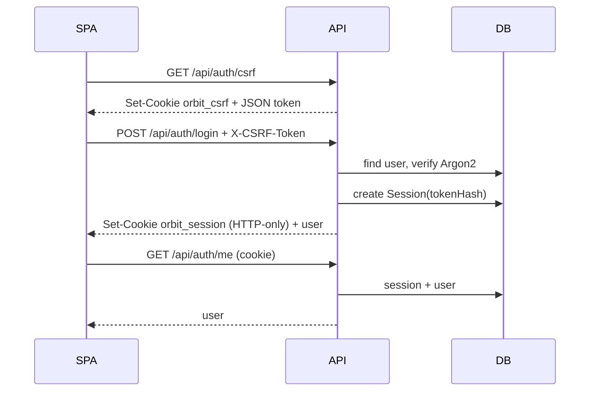
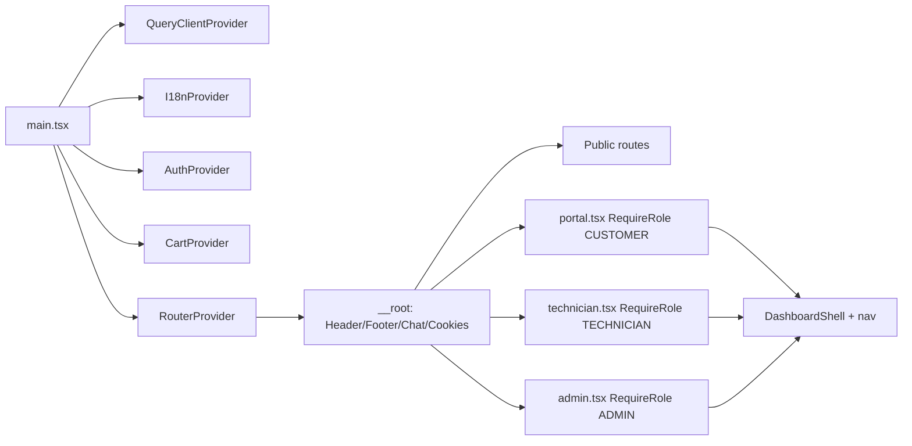
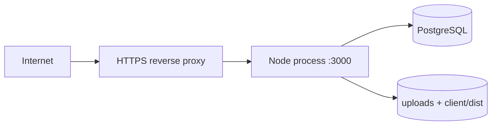

# Architecture

## 1. High-level overview

In development the React app runs on Vite (`:5173`) and proxies `/api` to
Express (`:3000`). In production Express serves `client/dist` and `/api` from the
same origin, which also simplifies cookies and CSRF.

---

## 2. Request lifecycle

Order in `src/app.ts` is important:

1. Helmet security headers
2. CORS with credentials
3. JSON/urlencoded body parsers (1 MB)
4. cookie-parser
5. CSRF protection
6. API rate limit
7. `attachUser`
8. Feature routers
9. Optional static SPA serving
10. 404 and central error handler

---

## 3. Authentication and CSRF

- Passwords: Argon2 (`@node-rs/argon2`).
- Session: random 32-byte token in an HTTP-only cookie. The DB stores only a
  SHA-256 hash. Expiry: 7 days.
- CSRF: double-submit cookie. `orbit_csrf` is readable by JS; every
  POST/PATCH/DELETE must send the same value in `X-CSRF-Token`.
- The API client fetches `/api/auth/csrf` before the first mutation and reads the
  cookie afterwards.
- `attachUser` loads the user for every `/api` request; routes decide whether
  login is required.
- Role checks are middleware (`requireRole`) plus ownership checks in handlers.

---

## 4. Frontend architecture

### Data fetching

- TanStack Query handles caching, loading and invalidation.
- Queries use stable keys: `["services"]`, `["requests"]`, `["ticket", id]`,
  `["chat", "thread", id]`, `["admin", "stats"]`.
- After mutations, the page invalidates the affected keys.
- Chat uses polling: 6–8 s while the widget/thread is open.

### State

- Server data: TanStack Query.
- Auth user: `AuthContext` (loaded from `/auth/me`).
- Cart: `CartContext` + localStorage.
- Language: `I18nContext` + localStorage.

No Redux or second router is used.

---

## 5. Backend architecture

Route modules:

| File | Responsibility |
| --- | --- |
| `auth.routes.ts` | CSRF, register, login, logout, me |
| `public.routes.ts` | Health, contact form |
| `catalog.routes.ts` | Services, categories, products + admin CRUD |
| `content.routes.ts` | Public CMS pages + admin CRUD |
| `requests.routes.ts` | Public quote requests, lists, assignment, status |
| `quotes.routes.ts` | Quote creation, send, accept/reject → order/invoice |
| `orders.routes.ts` | Product orders, order status, invoices |
| `tickets.routes.ts` | Tickets, messages, internal notes, assignment |
| `appointments.routes.ts` | Scheduling and status |
| `reports.routes.ts` | Service reports + protected file upload/download |
| `chat.routes.ts` | Guest chat, authenticated conversations, messages |
| `admin.routes.ts` | KPIs, users, contacts, activity |
| `profile.routes.ts` | Profile, password, notifications, GDPR export/delete |

Validation lives in one file so every route uses the same rules. Error handling
is centralised: Zod → 400, `AppError` → its status, Prisma `P2002` → 409,
`P2025` → 404, unknown → 500 without leaking stack traces.

---

## 6. Database design

See [database-erd.md](database-erd.md). Key ideas:

- `User` is the centre; roles are one enum column.
- `ServiceRequest` is the lead/project record.
- `Quote` has `QuoteItem`s and can produce one `Order`.
- `Order` has `OrderItem`s and one `Invoice`.
- `Ticket` has `TicketMessage`s; internal notes are filtered for customers.
- `Conversation` + `Message` support guest, support and direct chats.
- `ContentPage` stores bilingual sanitised HTML.
- `ActivityLog` and `Notification` give history and in-app updates.
- Soft delete (`User.deletedAt`) preserves business records.

Money is `Decimal(12,2)` in PostgreSQL. Values arrive in JSON as strings; the
frontend converts with `Number()` only for display/calculation.

---

## 7. File uploads

1. Technician submits `multipart/form-data` to `POST /api/reports`.
2. Multer stores the file under `storage/reports/<uuid>.<ext>`.
3. Only PDF/PNG/JPG up to 8 MB are accepted.
4. The DB stores the random filename, not a public URL.
5. Download goes through `GET /api/reports/:id/file`, which checks admin,
   technician or owning customer.
6. If validation fails after upload, the file is deleted.

---

## 8. Deployment

Recommended steps:

1. `cd client && npm ci && npm run build`
2. `cd server && npm ci && npx prisma migrate deploy && npx prisma generate`
3. Set production env (`NODE_ENV=production`, real `DATABASE_URL`,
   `CLIENT_ORIGIN`).
4. Run `npm start` behind Nginx/Caddy with HTTPS.
5. Back up PostgreSQL and `storage/`.
6. Serve `/api` and the SPA from the same domain.

The app is a single Node process, so vertical scaling is enough for a small
company. For multiple instances you would need shared file storage (S3) and a
shared session DB (already PostgreSQL) plus a load balancer.

---

## 9. Performance notes

- Route-level code splitting via TanStack Router.
- Query caching and stale times prevent repeated fetches.
- Images are CSS/emoji placeholders; no large assets.
- Database indexes on foreign keys and common filters.
- Chat polling only while open.
- Bundle is small; the main entry is around 475 kB uncompressed / 142 kB gzip in
  the demo build.

Future improvements: image uploads/CDN, cursor pagination for large lists,
WebSockets/SSE for chat, and Redis for rate-limit/session storage if scaled.
