# Database design and ERD

Database: PostgreSQL · ORM: Prisma 7 · Schema: `server/prisma/schema.prisma`

## 1. ERD

```mermaid
erDiagram
    USER ||--o{ SESSION : has
    USER ||--o{ SERVICE_REQUEST : "requests as customer"
    USER ||--o{ SERVICE_REQUEST : "is assigned as technician"
    SERVICE ||--o{ SERVICE_REQUEST : "is requested"

    SERVICE_REQUEST ||--o{ QUOTE : receives
    USER ||--o{ QUOTE : "owns as customer"
    USER ||--o{ QUOTE : "creates as admin"
    QUOTE ||--|{ QUOTE_ITEM : contains
    QUOTE |o--o| ORDER : "may become"

    USER ||--o{ ORDER : places
    ORDER ||--|{ ORDER_ITEM : contains
    ORDER ||--o| INVOICE : "is billed by"
    USER ||--o{ INVOICE : receives

    USER ||--o{ APPOINTMENT : "attends as customer"
    USER ||--o{ APPOINTMENT : "works as technician"
    SERVICE_REQUEST ||--o{ APPOINTMENT : schedules

    USER ||--o{ TICKET : "opens as customer"
    USER ||--o{ TICKET : "handles as technician"
    SERVICE_REQUEST ||--o{ TICKET : relates
    TICKET ||--o{ TICKET_MESSAGE : contains
    USER ||--o{ TICKET_MESSAGE : writes

    USER ||--o{ SERVICE_REPORT : writes
    SERVICE_REQUEST ||--o{ SERVICE_REPORT : documents
    TICKET ||--o{ SERVICE_REPORT : documents

    PRODUCT_CATEGORY ||--o{ PRODUCT : groups
    PRODUCT ||--o{ QUOTE_ITEM : "can be quoted"
    PRODUCT ||--o{ ORDER_ITEM : "can be ordered"

    USER ||--o{ CONVERSATION : "customer of"
    USER ||--o{ CONVERSATION : "creator of"
    CONVERSATION ||--o{ CONVERSATION_PARTICIPANT : includes
    USER ||--o{ CONVERSATION_PARTICIPANT : participates
    CONVERSATION ||--o{ MESSAGE : contains
    USER ||--o{ MESSAGE : sends

    USER ||--o{ CONTENT_PAGE : authors
    USER ||--o{ ACTIVITY_LOG : generates
    USER ||--o{ NOTIFICATION : receives

    USER {
        uuid id PK
        string email UK
        string passwordHash
        string fullName
        enum role "ADMIN | TECHNICIAN | CUSTOMER"
        string phone
        string companyName
        string address
        enum preferredLanguage "EN | DE"
        datetime acceptedTermsAt
        datetime acceptedPrivacyAt
        datetime createdAt
        datetime updatedAt
        datetime deletedAt
    }

    SESSION {
        uuid id PK
        uuid userId FK
        string tokenHash UK
        datetime expiresAt
        string userAgent
        string ip
        datetime createdAt
    }

    SERVICE {
        uuid id PK
        string slug UK
        string nameEn
        string nameDe
        text descriptionEn
        text descriptionDe
        string icon
        decimal startingPrice
        boolean active
        int sortOrder
    }

    PRODUCT_CATEGORY {
        uuid id PK
        string slug UK
        string nameEn
        string nameDe
    }

    PRODUCT {
        uuid id PK
        string slug UK
        string sku UK
        uuid categoryId FK
        string nameEn
        string nameDe
        text descriptionEn
        text descriptionDe
        decimal price
        int stock
        string imageUrl
        boolean active
        boolean featured
    }

    SERVICE_REQUEST {
        uuid id PK
        string reference UK
        uuid customerId FK
        uuid serviceId FK
        uuid assignedTechnicianId FK
        string title
        text description
        string siteAddress
        datetime preferredDate
        decimal budget
        enum status
        string contactName
        string contactEmail
        string contactPhone
        datetime consentAt
        datetime createdAt
        datetime updatedAt
    }

    QUOTE {
        uuid id PK
        string reference UK
        uuid requestId FK
        uuid customerId FK
        uuid createdById FK
        enum status
        datetime validUntil
        text notes
        decimal subtotal
        decimal taxRate
        decimal taxAmount
        decimal total
        datetime sentAt
        datetime acceptedAt
    }

    QUOTE_ITEM {
        uuid id PK
        uuid quoteId FK
        uuid productId FK
        string description
        int quantity
        decimal unitPrice
        decimal total
    }

    ORDER {
        uuid id PK
        string reference UK
        uuid customerId FK
        uuid quoteId FK "unique, nullable"
        enum status
        decimal subtotal
        decimal taxRate
        decimal taxAmount
        decimal total
        string shippingAddress
        text notes
        datetime termsAcceptedAt
        datetime createdAt
    }

    ORDER_ITEM {
        uuid id PK
        uuid orderId FK
        uuid productId FK
        string description
        int quantity
        decimal unitPrice
        decimal total
    }

    INVOICE {
        uuid id PK
        string number UK
        uuid orderId FK "unique"
        uuid customerId FK
        enum status
        decimal amount
        datetime issuedAt
        datetime dueAt
        datetime paidAt
    }

    APPOINTMENT {
        uuid id PK
        uuid customerId FK
        uuid technicianId FK
        uuid requestId FK
        string title
        text notes
        datetime startsAt
        datetime endsAt
        string location
        enum status
    }

    TICKET {
        uuid id PK
        string reference UK
        uuid customerId FK
        uuid requestId FK
        uuid assignedTechnicianId FK
        string subject
        text description
        string category
        enum priority
        enum status
        datetime createdAt
        datetime updatedAt
    }

    TICKET_MESSAGE {
        uuid id PK
        uuid ticketId FK
        uuid authorId FK
        string authorName
        text body
        boolean isInternal
        datetime createdAt
    }

    SERVICE_REPORT {
        uuid id PK
        uuid requestId FK
        uuid ticketId FK
        uuid technicianId FK
        string title
        text workDone
        decimal hours
        text materials
        string fileUrl
        string fileOriginalName
        enum status
        datetime submittedAt
        datetime approvedAt
    }

    CONVERSATION {
        uuid id PK
        string subject
        enum type "SUPPORT | DIRECT | GUEST"
        enum status
        uuid customerId FK
        uuid createdById FK
        string guestName
        string guestEmail
        string guestToken UK
        datetime consentAt
        datetime createdAt
        datetime updatedAt
    }

    CONVERSATION_PARTICIPANT {
        uuid id PK
        uuid conversationId FK
        uuid userId FK
        datetime lastReadAt
    }

    MESSAGE {
        uuid id PK
        uuid conversationId FK
        uuid senderId FK
        string senderName
        text body
        datetime createdAt
    }

    CONTENT_PAGE {
        uuid id PK
        string slug UK
        string titleEn
        string titleDe
        text bodyEn
        text bodyDe
        enum status "DRAFT | PUBLISHED"
        uuid authorId FK
        datetime publishedAt
    }

    CONTACT_MESSAGE {
        uuid id PK
        string name
        string email
        string phone
        string subject
        text message
        enum status
        datetime consentAt
        datetime createdAt
    }

    ACTIVITY_LOG {
        uuid id PK
        uuid userId FK
        string action
        string entityType
        string entityId
        text description
        datetime createdAt
    }

    NOTIFICATION {
        uuid id PK
        uuid userId FK
        string title
        text message
        string link
        datetime readAt
        datetime createdAt
    }
```



> Mermaid renders the full relationship set in the app/IDE. The diagram above is
> also the quickest way to explain the project during the presentation.

---

## 2. Enums

| Enum | Values |
| --- | --- |
| `UserRole` | `ADMIN`, `TECHNICIAN`, `CUSTOMER` |
| `PreferredLanguage` | `EN`, `DE` |
| `RequestStatus` | `NEW`, `REVIEWING`, `QUOTED`, `APPROVED`, `SCHEDULED`, `IN_PROGRESS`, `COMPLETED`, `CANCELLED` |
| `QuoteStatus` | `DRAFT`, `SENT`, `ACCEPTED`, `REJECTED`, `EXPIRED` |
| `OrderStatus` | `PENDING`, `CONFIRMED`, `PROCESSING`, `COMPLETED`, `CANCELLED` |
| `InvoiceStatus` | `ISSUED`, `PAID`, `OVERDUE`, `CANCELLED` |
| `AppointmentStatus` | `SCHEDULED`, `CONFIRMED`, `COMPLETED`, `CANCELLED` |
| `TicketStatus` | `OPEN`, `IN_PROGRESS`, `WAITING_CUSTOMER`, `RESOLVED`, `CLOSED` |
| `TicketPriority` | `LOW`, `MEDIUM`, `HIGH`, `URGENT` |
| `ReportStatus` | `DRAFT`, `SUBMITTED`, `APPROVED` |
| `ConversationType` | `SUPPORT`, `DIRECT`, `GUEST` |
| `ConversationStatus` | `OPEN`, `CLOSED` |
| `ContentStatus` | `DRAFT`, `PUBLISHED` |
| `ContactStatus` | `NEW`, `READ`, `REPLIED` |

---

## 3. Core rules

### Request → quote → order

1. A `ServiceRequest` is created by a visitor/customer.
2. An admin links it to a customer account if it was a lead.
3. An admin creates a `Quote` (status `DRAFT`).
4. Sending sets `SENT`, sets request status `QUOTED`, notifies the customer.
5. Customer accepts:
   - quote → `ACCEPTED`,
   - request → `APPROVED`,
   - an `Order` + `Invoice` are created,
   - stock is decremented for linked products.
6. Admin can later move the order to `COMPLETED` and mark the invoice `PAID`.

### Tickets

- Customers see their own tickets only.
- Technicians see assigned tickets only.
- Admins see all tickets.
- `isInternal = true` messages are excluded from customer responses.
- Staff replies set status `WAITING_CUSTOMER`; customer replies set
  `IN_PROGRESS`.

### Chat

- `GUEST`: no account; access is protected by a random `guestToken` stored in
  the browser. Admins can see and reply.
- `SUPPORT`: a customer conversation; admins can see all.
- `DIRECT`: internal staff conversation; only participants and admins.
- Participants are stored in `ConversationParticipant`.

### Deletion and retention

- Users are soft-deleted (`deletedAt`) and personal fields anonymised on GDPR
  deletion.
- Invoices and related order records stay for the statutory retention period.
- Services/products are archived (`active = false`) rather than hard-deleted so
  old quotes/orders still render.
- CMS pages can be hard-deleted because they have no financial relevance.

---

## 4. Indexes

- Unique: user email, slugs, SKUs, references, invoice number, session token hash,
  guest token, one order per quote, one invoice per order.
- Foreign-key indexes: requests (customer, status), quotes (customer), orders
  (customer), invoices (customer), tickets (customer, technician), reports
  (technician), conversations (customer), messages (conversation), notifications
  (user), activity (user).

---

## 5. Money and tax

- All monetary columns are `Decimal(12,2)` / `Decimal(10,2)`.
- VAT is stored per quote/order (`taxRate`), default 19 %.
- Values arrive in JS as strings; display with `Intl.NumberFormat("de-DE" /
  "en-GB", { style: "currency", currency: "EUR" })`.
- Rounding happens in `server/src/utils/helpers.ts` (`round2`).

---

## 6. How to change the schema safely

```bash
cd server
# 1. Edit prisma/schema.prisma
npx prisma migrate dev --name short_description
npx prisma generate
# 2. Update seed data if needed
npm run db:seed
# 3. Update types on the frontend contract if the API changes
npm run build && npm test
```

For production use `npx prisma migrate deploy` (never `migrate dev`).
