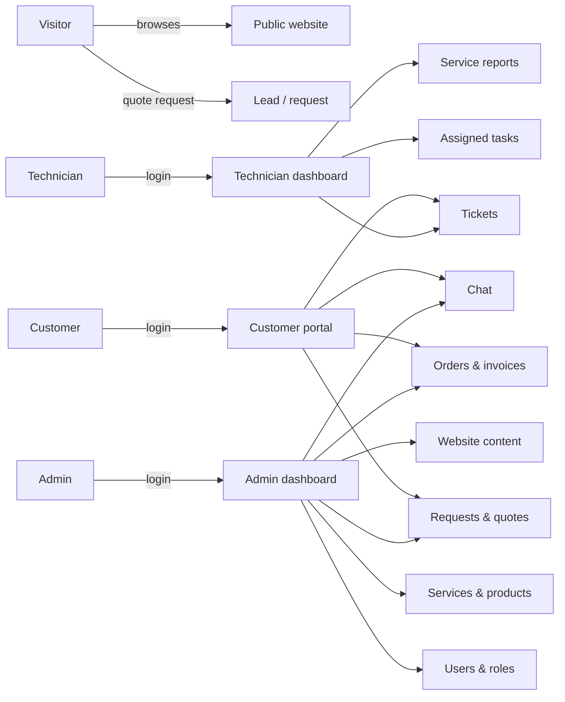
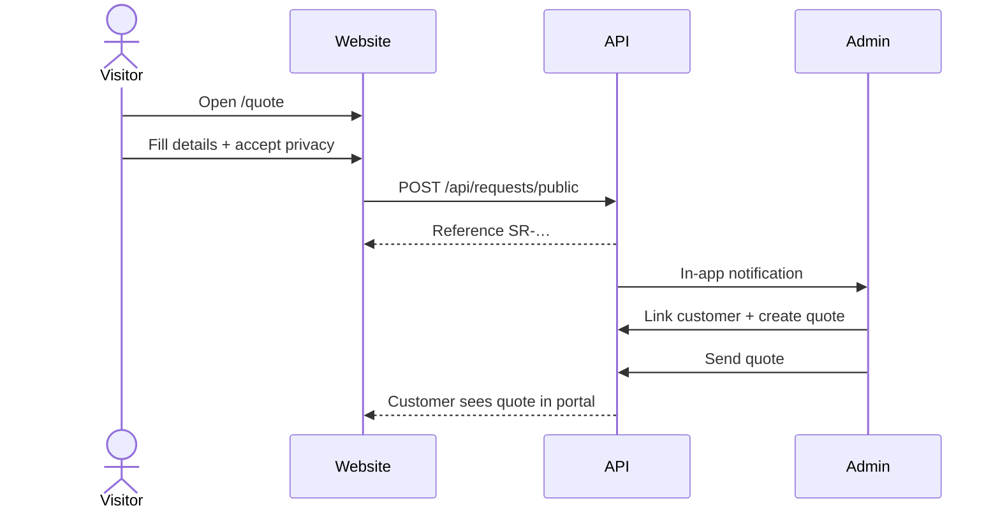
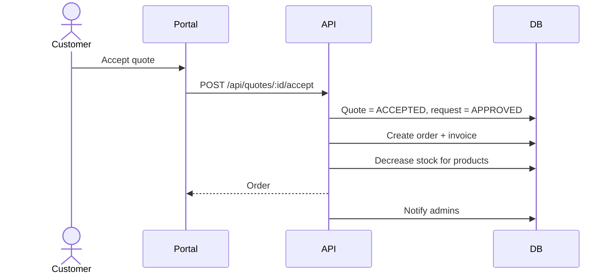
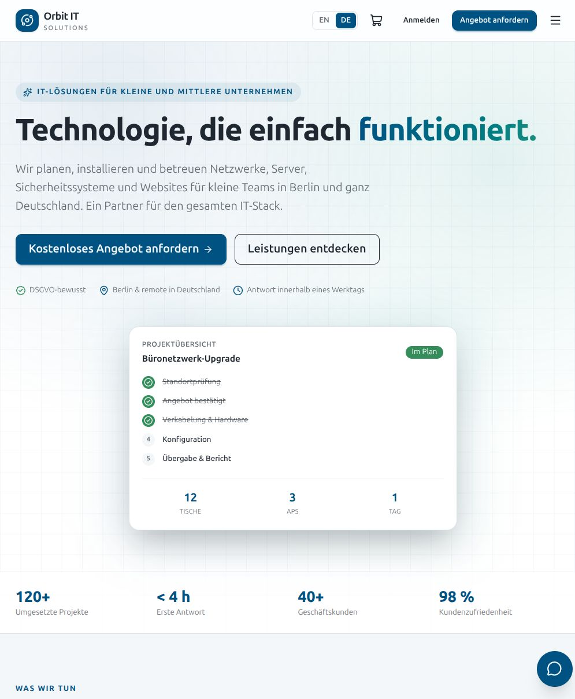
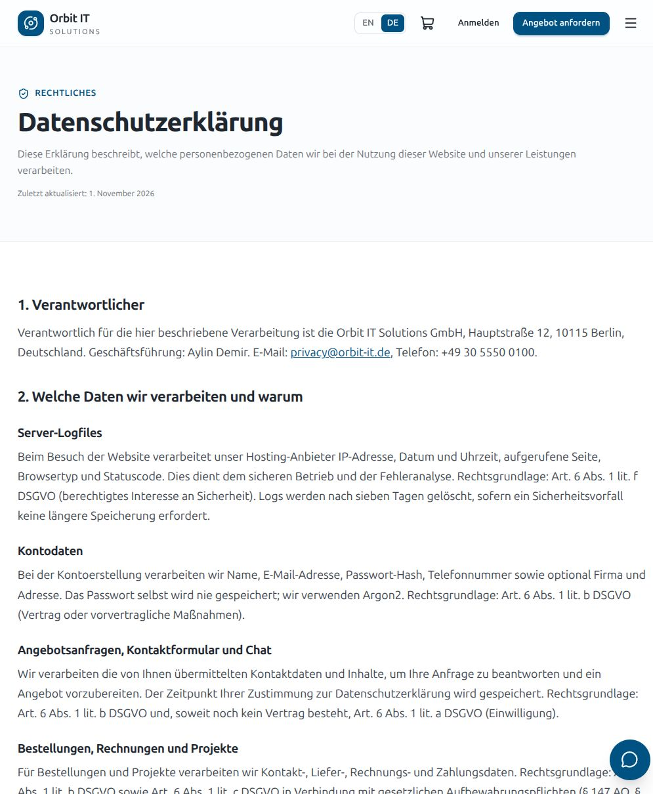
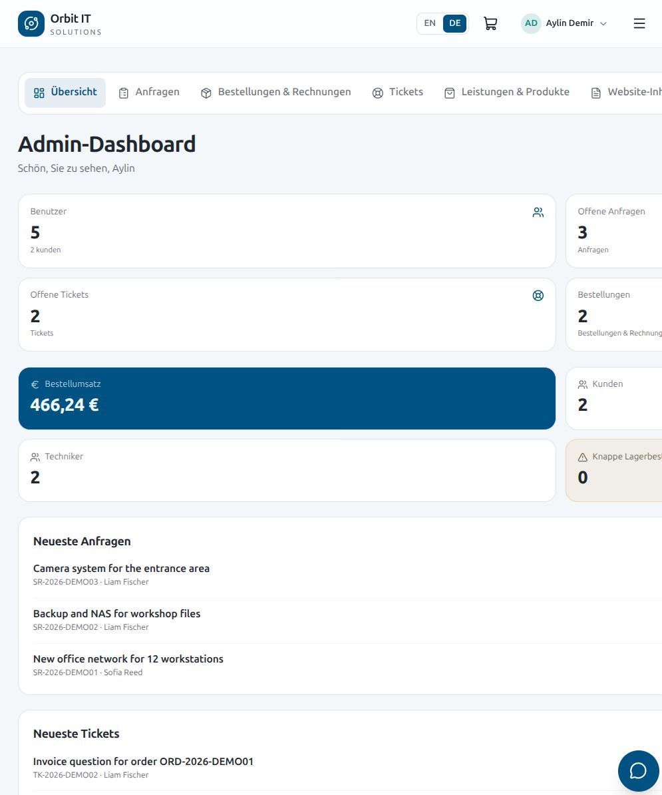

# Project description — Orbit IT Solutions Platform

## 1. Project idea

Orbit IT Solutions is a fictional small IT services company. The project is a
full-stack web platform that combines three things a company like this needs:

1. A professional public website with services, products and a way to request a
   quote.
2. A customer portal where clients can follow requests, quotes, orders, tickets
   and appointments.
3. Internal dashboards where technicians and admins manage the actual work.

The platform is intentionally sized for a **small or medium business**, not an
enterprise. It should be understandable by three junior developers and usable on
a normal laptop.

> All company data, people, prices and legal texts are demo content.

---

## 2. Problem

Small IT companies often run on a mix of email, WhatsApp, spreadsheets and paper
quotes. This creates typical problems:

- Customers do not know the status of their request.
- Quotes and approvals get lost in inboxes.
- Technicians receive tasks verbally or in chat.
- Invoices and service reports are hard to find later.
- The website shows services but cannot capture a structured request.
- Privacy obligations (GDPR, cookie rules, Impressum, AGB) are forgotten.

## 3. Goals

| Goal | How the platform addresses it |
| --- | --- |
| Professional public presence | Bilingual marketing website with services, shop, insights and contact |
| Structured lead capture | Quote request form with service, budget, date, address and consent |
| Transparent customer process | Portal with request status, quotes, orders, invoices, reports |
| Clear internal work | Technician dashboard and admin task assignment |
| Support that is trackable | Tickets with messages, priorities, assignment and internal notes |
| Simple communication | Guest chat, customer support chat, private staff chat |
| Legal readiness | Impressum, privacy, terms, withdrawal, cookie policy, consent records, data export/deletion |
| Safe defaults | Server-side sessions, CSRF, role checks, validation, rate limits |

## 4. Non-goals (MVP)

- No real payment provider integration (invoices are recorded, not paid online).
- No email sending (notifications are in-app only).
- No real-time WebSockets (chat uses short polling).
- No multi-language content beyond English/German.
- No mobile app.
- No advanced accounting, stock forecasting or procurement.
- No AI features.

These are reasonable later extensions, not requirements.

---

## 5. Users and roles

### Visitor

- Browses services, products, blog and legal pages.
- Requests a quote without an account.
- Sends a contact message or starts a guest chat.
- Can register to become a customer.

### Customer

Individuals, small businesses and firms. Can:

- maintain a profile and preferred language,
- submit and cancel requests,
- accept or reject quotes,
- view orders and invoices,
- open tickets and reply,
- view appointments and service reports,
- chat with the team,
- download personal data and delete the account.

### Technician

- Sees assigned requests, tickets and appointments.
- Updates request/ticket status.
- Submits service reports with hours, materials and an optional PDF/image.
- Chats with the team and customers.

### Admin

- Manages users and roles.
- Manages services, products and categories.
- Reviews requests, links leads to customer accounts, assigns technicians.
- Creates and sends quotes.
- Manages orders and marks invoices as paid.
- Handles tickets and contact messages.
- Edits website content with a rich-text editor.
- Sees KPIs and activity.

---

## 6. Main user journeys

### 6.1 Visitor requests a quote

### 6.2 Customer accepts a quote

### 6.3 Technician completes a task

1. Technician opens a request from the dashboard.
2. Changes status to `IN_PROGRESS` and later `COMPLETED`.
3. Submits a service report with hours and an optional file.
4. Customer sees the status and report in the portal.
5. Admin can approve the report.

### 6.4 Customer uses privacy tools

1. Customer opens **Profile & privacy**.
2. Clicks **Download my data** → JSON export.
3. Or deletes the account with password confirmation.
4. Personal data is anonymised; invoices remain for the legal retention period.

---

## 7. Feature scope (MVP)

### Public

- Home with hero, 10 service areas, process, featured products, insights, CTA.
- Service list + service detail.
- Product catalog with category filter, search and stock.
- Product detail, cart, checkout for logged-in customers.
- Quote request, contact form, guest chat.
- Login/register with legal consent.
- Blog/insights from the CMS.
- Impressum, privacy, AGB, withdrawal, cookie policy, cookie settings.

### Customer portal

- Dashboard with counts, recent requests/tickets, appointments, notifications.
- Requests list/detail with quotes (accept/reject), reports, appointments.
- Orders with invoice information and print view.
- Tickets with thread and replies.
- Appointments with confirm/cancel.
- Reports with download.
- Chat.
- Profile, password, language, data export, account deletion.

### Technician

- Overview with counts and next appointments.
- Assigned requests with status update.
- Tickets with status, assignment and internal notes.
- Appointments.
- Service report form with upload.

### Admin

- KPI dashboard.
- User management and roles.
- Request management, technician assignment, lead → customer linking.
- Quote builder with line items, tax, validity, send.
- Orders and invoice payment status.
- Ticket management and assignment.
- Catalog CRUD.
- CMS with bilingual rich-text editor and publish/draft.
- Chat overview, direct staff chats.
- Contact inbox.
- Activity log.

---

## 8. Success criteria

- A visitor can request a quote in under two minutes.
- A customer can see the quote, accept it and find the invoice without help.
- A technician can update a task and upload a report in under one minute.
- An admin can create a quote with multiple line items and send it.
- All pages work in English and German.
- All legal links are reachable from every page.
- `npm run build` and `npm test` pass.
- No critical security issue in the checklist in `docs/security-privacy.md`.

---

## 9. Roadmap (project phases)

| Phase | Output |
| --- | --- |
| 1. Planning | Idea, roles, MVP scope, success criteria |
| 2. Design | Data model, ERD, wireframe structure, design tokens |
| 3. Development | API, database, frontend, admin, CMS, chat |
| 4. Testing | Unit/API tests, manual flows, accessibility and responsiveness |
| 5. Deployment & presentation | Production build, docs, slides, demo script |

---

## 10. Risks and mitigations

| Risk | Mitigation |
| --- | --- |
| Scope too large for three juniors | Clear MVP, feature-based folders, no payment/email integration |
| Frontend changes break the API | `AGENTS.md` boundaries, shared `types.ts`, handoff files |
| Legal texts are wrong | Marked as templates; checklist; lawyer review before launch |
| Security shortcuts | Server-side checks, tests, review checklist |
| Demo data looks empty | Seed with 10 services, 14 products, users and sample workflows |
| Chat feels slow | 6–8 s polling is acceptable for MVP; WebSockets are a later upgrade |

---

## 11. Presentation angle

The project demonstrates that a small team can deliver a realistic business
application with:

- a proper relational data model,
- role-based access control,
- a complete quote → order → invoice flow,
- bilingual UX,
- and privacy features that go beyond a cookie banner.

See `docs/presentation-outline.md` and `docs/demo-script.md`.

---

## 12. Screenshots

| Home (German) | Privacy policy (German) | Admin dashboard |
| --- | --- | --- |
|  |  |  |

> Screenshots from the demo build. The layout is responsive; at desktop widths
> the dashboard navigation becomes a vertical sidebar.
